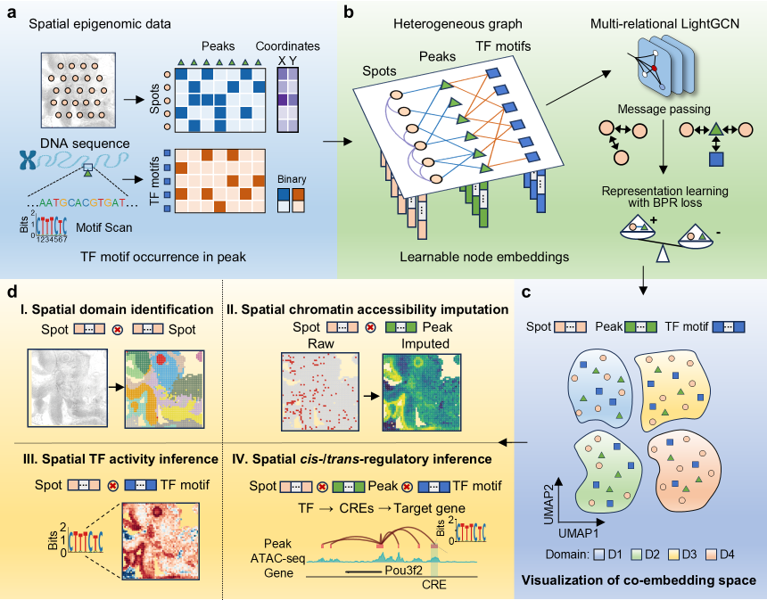

# SEAREG

**Dissecting spatially resolved chromatin regulation from spatial epigenomics data.**

SEAREG is a multi-relational heterogeneous graph representation learning framework that connects tissue organization with chromatin regulatory features. It learns shared representations of tissue spots and genomic peaks, incorporating transcription factor (TF) motif nodes in sequence-informed analyses.



## From tissue domains to regulatory features

The manuscript uses these shared representations for four complementary analyses:

- **Spatial domain identification:** delineate tissue regions and connect them to associated peaks and TF motifs.
- **Spatial chromatin accessibility imputation:** derive inferred peak-level spatial profiles from spot–peak embedding similarity.
- **Spatial TF activity inference:** map motif-informed TF association profiles across the tissue.
- **Spatial cis-/trans-regulatory inference:** combine learned profiles, sequence matches and downstream peak–gene evidence to prioritize candidate TF–element–target relationships.

The manuscript investigates regional and interface-associated chromatin features in the mouse embryo, ATAC/H3K27ac programs in the P22 brain, and B-cell-state and receptor-associated programs in human tonsil. The two P22 assays are modeled independently before regional comparison. The developmental study uses a motif-free joint spot–peak representation across developing mouse brain stages. See [method and score interpretation](docs/unified_framework.rst).

## Tutorials

The six notebooks cover input preparation, model training, spatial domain identification, spot UMAP and joint node visualization. T1–T5 model individual sections with motif information; T6 jointly models four developing mouse brain sections with shared peaks. Named embedding exports provide the starting point for further regulatory-feature analyses.

| Tutorial | Dataset | Notebook |
| --- | --- | --- |
| 1 | Mouse embryo (E13, spatial ATAC–RNA-seq) | [T1](tutorials/T1_Mouse_Embryo_E13_Spatial_ATAC_RNA.ipynb) |
| 2 | Mouse embryo (E13, spatial-ATAC-seq) | [T2](tutorials/T2_Mouse_Embryo_E13_Spatial_ATAC.ipynb) |
| 3 | Mouse brain (P22, spatial ATAC–RNA-seq) | [T3](tutorials/T3_Mouse_Brain_P22_Spatial_ATAC_RNA.ipynb) |
| 4 | Mouse brain (P22, spatial CUT&Tag–RNA-seq, H3K27ac) | [T4](tutorials/T4_Mouse_Brain_P22_Spatial_CUTTag_RNA_H3K27ac.ipynb) |
| 5 | Human tonsil (spatial-ATAC-seq) | [T5](tutorials/T5_Human_Tonsil_Spatial_ATAC.ipynb) |
| 6 | Developing mouse brain (E11.0–E18.5, MISAR-seq) | [T6](tutorials/T6_Mouse_Brain_Development_MISAR_seq.ipynb) |

T1 also demonstrates spatial feature scores for a peak and a TF motif.

T6 uses `adaptive_depth_gate` to reduce the influence of spots with locally anomalous sequencing depth during joint-section learning. Its correction combines null-calibrated donor weights, risk-modulated boundary protection, donor coherence and a per-section 3% reference displacement budget. It trains from counts and uses the completed job’s final embeddings for domains and UMAPs. The saved example exports, analysis, figures and `tutorial_execution.json` are under `result/Embryo_multislice/adaptive_depth_gate/`. See [developing mouse brain](docs/multislice.rst) for input preparation, configuration and reopening the saved results.

The model inputs are chromatin counts, spatial coordinates and optional motif annotations. RNA informs downstream biological interpretation and selected reference-guided analyses in the manuscript. The tutorials prepare the data and network, train SEAREG, and use each trained model’s final embeddings for downstream analysis and visualization.

## Getting started

Use a complete GitHub checkout or **Download ZIP** for the notebooks, compressed example inputs and provided embeddings. Install the pinned Python 3.10.22 environment on Linux; the default uses PyTorch 2.2.0 with CUDA 12.1. The [installation guide](docs/installation.rst) also covers CPU execution and package-only installation.

```bash
git clone https://github.com/xmyjy/SEAREG.git
cd SEAREG
conda env create -f environment.yml
conda activate seareg
python -m pip install "torch==2.2.0+cu121" --index-url https://download.pytorch.org/whl/cu121
python -m pip install "triton==2.2.0"
python -m pip install -r requirements.txt
python -m pip install --no-build-isolation --no-deps -e .
python -m pip check
conda install -c conda-forge tmux
jupyter lab tutorials/T1_Mouse_Embryo_E13_Spatial_ATAC_RNA.ipynb
```

Configure the paths, output directory, device and parameters in the first code cell, then run the cells in order. All six tutorials default to `RUN_MODE="train"`: they prepare the data and network, train in independent tmux jobs and analyze each completed job's final embeddings. See the [tutorial guide](tutorials/README.md).

## Data and results

The default example paths are relative to the repository root. `data/<dataset>/` contains compressed counts and, for T1–T5, motif annotations; the notebooks prepare them automatically. T6 also includes tissue annotations and display palettes. GitHub Download ZIP and clone include the input bytes, with no separate data download or Git LFS client. Your own input and output paths may be outside the repository. See [input data](data/README.md).

Included trained embeddings are under `result/`. New training saves its model exports, analysis and figures in a separate run directory under `OUTPUT_DIR`. See [result layout](result/README.md).

## Running the tutorials

The first code cell contains the complete configuration. For T1–T5 with your own single-section data, change its existing assignments, for example:

```python
DATASET = "my_section"             # A run label.
ATAC_PATH = Path("/data/my_section/counts.h5ad")
MOTIF_PATH = Path("/data/my_section/motifs.h5")
OUTPUT_DIR = Path("/results/my_section")
TARGET_K = 8                       # Choose for your data.
RUN_MODE = "train"
```

The same cells prepare inputs, filter counts, prepare motif associations and the network, train, analyze and plot. `MOTIF_OPTIONS` controls reading, scanning or disabling motifs; the option dictionaries expose training, network and analysis settings. See the [unified configuration example](tutorials/README.md#configure-the-inputs-and-parameters).

Choose `TARGET_K` for your single-section data. For joint analyses of your own sections, configure the [T6 section and display options](tutorials/README.md#joint-developmental-sections-t6).

Notebook training runs in an independent tmux job, so closing the notebook does not stop it. The generated `training_job/TRAINING_HANDOFF.md` records progress, logs, checkpoints and recovery commands. Use `sr.load_training_job(job_path).wait()` to reconnect. See [workflow and recovery](docs/workflow.rst) for save schedules and compatible checkpoint recovery. The [Python/CLI guide](docs/continuous_pipeline.rst) also explains synchronous calls and detached jobs for your own workflows.

For new data, the Python/CLI workflow chooses omitted epochs and shard counts from the filtered spot–peak graph: 500 epochs for more than 2,500 total spots, otherwise 300, and `max(10, ceil(E / 700000))` shards for `E` distinct positive pairs. Joint sections use their own edge counts and the joint spot total. Explicit settings take precedence; the six tutorials keep their recorded configurations. See [new-data defaults and stage helpers](docs/continuous_pipeline.rst).

Select a physical GPU for training with `SEAREG_PHYSICAL_GPU` (T1–T5 default 0; T6 example default 1). For CPU training, install the CPU PyTorch build and set `TRAINING_OPTIONS["device"] = "cpu"` and `EXECUTION_OPTIONS["physical_gpu"] = None` in the configuration cell. Both training devices use tmux.

## Analyze existing embeddings

To reanalyze an existing export instead of training, set `RUN_MODE="provided"`, choose `EMBEDDING_DIR` and set `ATAC_PATH` to its matching counts. This alternative skips model training and writes new analysis and figures. To read saved labels and coordinates without fitting, reopen the saved `analysis/` directory. See [source selection](tutorials/README.md#analyze-existing-embeddings).

## Documentation

- [Online documentation](https://seareg.readthedocs.io/en/latest/)
- [Tutorial guide](tutorials/README.md)
- [Method, feature scores and training configuration](docs/unified_framework.rst)
- [Input data](data/README.md) and [result layout](result/README.md)
- [Installation](docs/installation.rst) and [workflow](docs/workflow.rst)
- [Input schema](docs/input_data.rst) and [motif annotation](docs/motif_annotation.rst)
- [Python API](docs/api.rst)
- [Development checks](CONTRIBUTING.md)

The bundled datasets come from [Zhang et al. (2023)](https://doi.org/10.1038/s41586-023-05795-1), [Deng et al. (2022)](https://doi.org/10.1038/s41586-022-05094-1) and [Jiang et al. (2023)](https://doi.org/10.1038/s41592-023-01884-1). See [data sources](docs/data_access.rst) for sample identities and accessions. Citation metadata for the software is in [CITATION.cff](CITATION.cff).

SEAREG source is distributed under the [MIT License](LICENSE). Bundled components retain their own licenses; see [third-party notices](seareg/THIRD_PARTY_NOTICES.md).
